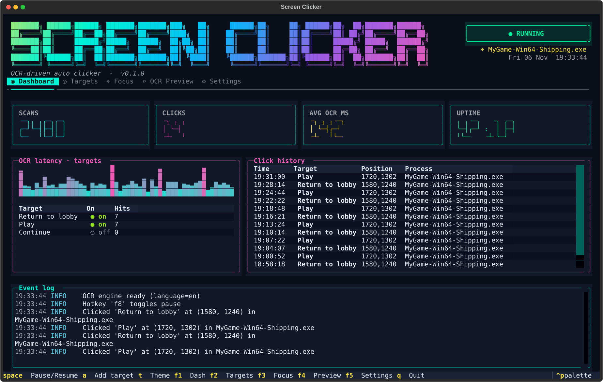
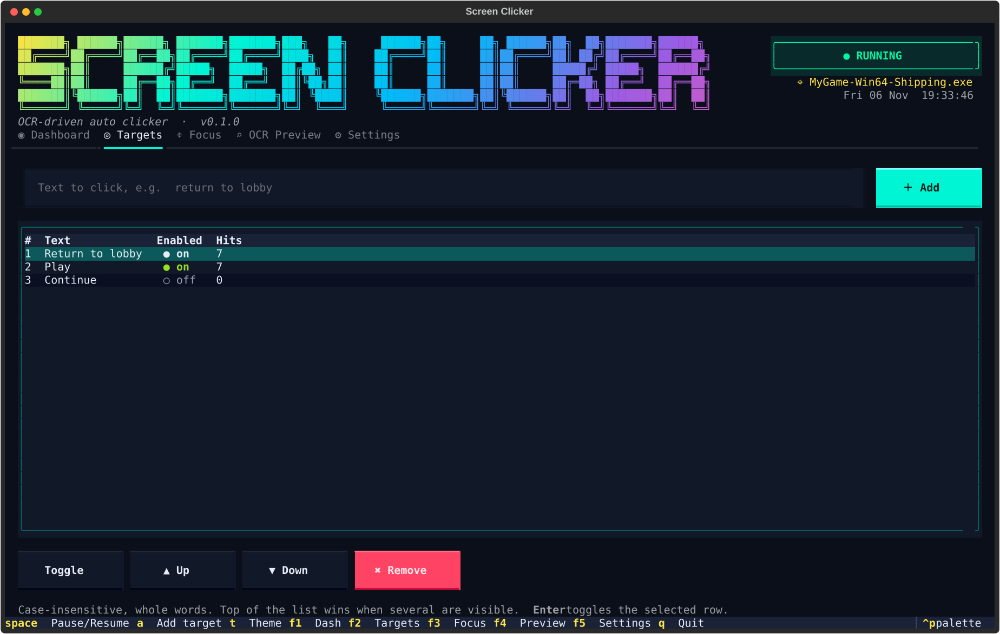
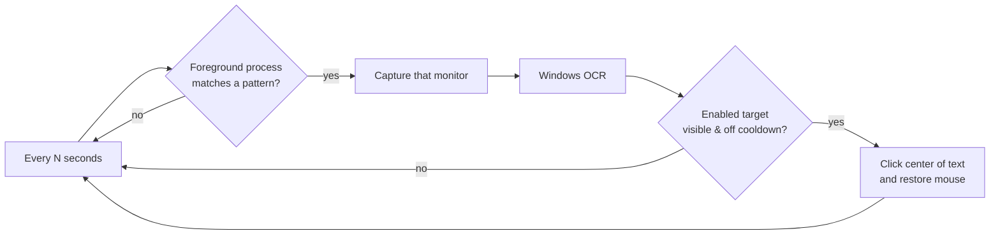

<div align="center">

# Screen Clicker

**An OCR-driven auto clicker for Windows with a terminal UI.**
It watches the screen for text you choose, like _"Return to lobby"_, _"Play"_ or _"Accept"_, and clicks it for you.



</div>

## Features

- **Text-based detection.** Uses the OCR engine built into Windows, so it works at any resolution, UI scale or theme without image templates.
- **Whole-word, case-insensitive matching.** `play` matches _PLAY_ and _Play!_ but not _Player_ or _Playlist_.
- **Ordered targets.** Add, remove, reorder and enable/disable targets on the fly. When several are visible, the one highest in the list is clicked first.
- **Focus guard.** Only clicks while the foreground window belongs to a matching process (glob patterns such as `mygame*.exe`).
- **Per-target cooldown**, so the same button isn't clicked repeatedly.
- **Multi-monitor aware.** Scans only the monitor the foreground window is on.
- **Terminal UI** with live stats, an OCR latency graph, click history, an event log, an OCR preview and a settings editor. It has its own neon theme plus all of Textual's built-in themes.
- **Global pause hotkey** (default `F8`) and a **system tray icon** that changes color with the current state.
- **Headless mode** for running with only the tray icon.
- **Optional click screenshots**, with the clicked area marked, for debugging.
- **Single `.exe` build** with PyInstaller.



## How it works



## Requirements

- Windows 10 or 11
- An installed Windows OCR language pack. English is usually present. To add another language, run this in an **admin** PowerShell:
  ```powershell
  Add-WindowsCapability -Online -Name "Language.OCR~~~en-US~0.0.1.0"
  ```
- To run from source: Python 3.13 (the released exe needs nothing extra)

## Getting started

### Option A: Download the `.exe` (easiest)

1. Download **`screen-clicker.exe`** from the [latest release](https://github.com/soelvberg/screen-clicker/releases/latest). No Python or installer needed.
2. Put it in its **own folder that you can write to**, for example `C:\Tools\ScreenClicker\`. Avoid `Program Files`. `config.yaml` and `logs\` are created next to the exe.
3. **Double-click** it. The TUI opens in a terminal window.

> - The exe isn't code-signed, so Windows SmartScreen may warn on first run. Choose _More info → Run anyway_. Some antivirus tools also flag PyInstaller apps by mistake. You can check the download against `screen-clicker.exe.sha256` with `Get-FileHash screen-clicker.exe`.
> - Startup takes a few seconds while the bundled runtime unpacks.
> - The TUI looks best in [Windows Terminal](https://aka.ms/terminal), the default on Windows 11. On Windows 10, set Windows Terminal as the _default terminal application_ in its settings so a double-click opens there instead of the classic console.

#### Run in the background (tray only)

Create a shortcut to the exe, open its **Properties** and add `--headless` to the target:

```text
C:\Tools\ScreenClicker\screen-clicker.exe --headless
```

A console window flashes briefly and closes, leaving only a tray icon (right-click it to pause or quit). Tip: set the shortcut's _Run_ option to **Minimized** to hide the flash. To start it with Windows, press `Win+R`, type `shell:startup` and put the shortcut in the folder that opens.

### Option B: Build the `.exe` yourself

```powershell
git clone https://github.com/soelvberg/screen-clicker.git
cd screen-clicker
powershell -ExecutionPolicy Bypass -File build.ps1
```

This produces `dist\screen-clicker.exe`.

### Option C: Run from source

```powershell
py -3.13 -m venv .venv
.venv\Scripts\activate
pip install -r requirements.txt
python -m screen_clicker
```

### First run

1. **Targets tab (`F2`):** add the texts you want clicked, for example `return to lobby` and `play`.
2. **Focus tab (`F3`):** switch to the target app once, come back, and pick its process from _Recent foreground processes_. Or type a glob such as `mygame*`.
3. **OCR Preview tab (`F4`):** check what the OCR reads on screen, which helps you pick exact texts.
4. Switch to your app. The status changes to **RUNNING** and matching buttons get clicked.
5. Optional: once it works, close the TUI and run it [in the background](#run-in-the-background-tray-only). It uses the same `config.yaml`.

## Usage

```text
screen-clicker.exe [-c CONFIG] [--headless]

  -c, --config CONFIG   Path to config.yaml (default: next to the exe; from source: current dir)
  --headless            No TUI, tray icon only
```

### Key bindings

| Key                           | Action                                               |
| ----------------------------- | ---------------------------------------------------- |
| `Space`                       | Pause / resume                                       |
| `F8` _(global, configurable)_ | Pause / resume from any app                          |
| `a`                           | Add a target                                         |
| `F1`–`F5`                     | Dashboard · Targets · Focus · OCR Preview · Settings |
| `Enter`                       | Toggle the selected target                           |
| `t`                           | Switch to the next theme                             |
| `Ctrl+S`                      | Save settings                                        |
| `Esc`                         | Move focus out of the current input                  |
| `Ctrl+P`                      | Command palette                                      |
| `q`                           | Quit                                                 |

### Status

| Status                  | Meaning                                                           |
| ----------------------- | ----------------------------------------------------------------- |
| ● **RUNNING**           | A matching app is in front; scanning and clicking                 |
| ◍ **WAITING FOR FOCUS** | The foreground window doesn't match (or is Screen Clicker itself) |
| ⏸ **PAUSED**            | Paused with the hotkey, tray menu or `Space`                      |
| ✖ **ERROR**             | For example, the OCR language isn't installed (see the event log) |

## Configuration

Everything can be edited in the TUI, which saves changes immediately. You can also edit `config.yaml` by hand:

```yaml
interval_seconds: 1.0 # time between scans
cooldown_seconds: 5.0 # min. time before the same target is clicked again
targets: # case-insensitive, whole words; top = highest priority
  - text: return to lobby
  - text: play
  - text: continue
    enabled: false
process_patterns: # glob, case-insensitive; empty = any window
  - mygame*
ocr_language: en # Windows OCR language tag
max_ocr_height: 1440 # downscale taller screens before OCR (speed vs. accuracy)
restore_mouse: true # move the cursor back after clicking
hotkey_pause: f8 # e.g. f8, ctrl+shift+p
run_as_admin: false # relaunch elevated via UAC (only if the target app runs as admin)
logging:
  file: logs/screen-clicker.log
  save_click_screenshots: true
  screenshot_dir: logs/clicks
```

Relative paths are resolved against the folder that contains `config.yaml`.

## Tips

- **Games:** use _windowed fullscreen_ / _borderless_ mode. Exclusive fullscreen often makes screen captures come out black.
- **Admin apps:** if the target app runs as administrator, Windows blocks clicks from non-elevated programs. Turn on **Run as administrator** in Settings.
- **Speed:** a 1440p screen typically takes 100–600 ms to OCR, depending on how much text is on it. Lower `max_ocr_height` (for example to `1080`) for faster scans.
- **Short targets:** single short words like _OK_ can show up in many places. Restrict the process patterns or use a longer phrase.

## Development

```powershell
pip install -r requirements.txt   # editable install + dev tools
pytest                            # unit tests
textual run --dev src/screen_clicker/__main__.py   # live CSS reload & devtools
```

```text
src/screen_clicker/
├─ __main__.py     CLI entry: TUI or --headless
├─ config.py       load / save / validate config.yaml
├─ focus.py        foreground process + monitor detection, glob matching
├─ detector.py     screen capture (mss) + Windows OCR (WinRT)
├─ matching.py     whole-word target matching
├─ clicker.py      SendInput mouse clicks
├─ engine.py       scan loop, cooldowns, events
├─ hotkey.py       global pause hotkey (pynput)
├─ tray.py         system tray icon (pystray)
├─ elevate.py      optional UAC relaunch
└─ tui/            Textual app, animated logo, theme
```

## Disclaimer

Automating input may break the terms of service of some games and applications, and anti-cheat systems may detect it. You are responsible for how you use this tool.
